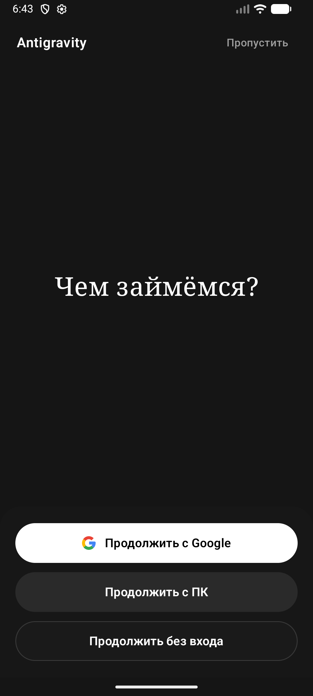

# Google AI Pro в приложении: перенос механизма confeden/Antigravity

Цель: аккаунт Google с подпиской работает в мобильном клиенте напрямую, без ключа
Gemini API, без ПК-моста, без VPN и без смены региона аккаунта.

Источник механизма — [confeden/Antigravity](https://github.com/confeden/Antigravity)
(«Antigravity в России без VPN и смены региона аккаунта Google»). Там всё сделано
для настольного клиента: патч строки в бинаре и служба с подменяющим DNS. У нас в
руках собственный клиент, поэтому переносится **смысл** правок, а не байты.

## Что именно перенесено

| Способ на ПК | Здесь | Где в коде |
| --- | --- | --- |
| `ineligible` → `inexigible` в `language_server` (снимает региональный отказ) | Ответ `loadCodeAssist` не считается приговором: причина сохраняется, запросы уходят дальше | `CloudCodeClient.parseCodeAssist`, поле `passedGate` |
| Хост переключается на `daily-cloudcode-pa` (`--cloud_code_endpoint`) | Первый хост — `daily-`, второй — `cloudcode-pa`, оба в списке подмены | `GoogleProConfig.PRIMARY_HOST`, `CloudCodeClient.call` |
| DNS-правила NRPT + локальный прокси на `127.0.0.1:53129` | `OkHttp.Dns` на маршрут: приложение само ходит к подменённому адресу, TLS и сертификат обычные | `RegionGateResolver`, `CloudCodeClient.clientFor` |
| Проверка подмены: ответ провайдера сверяется с эталонным резолвером, заглушки DPI выбрасываются | То же правило в чистой функции | `classifyAnswer` |
| Провайдеры `dns-ai.ru` (DoH) и `eu.geohide.ru` (UDP) + пользовательский DNS | Провайдеры в постоянном списке, маршрут выбирается по факту ответа модели | `GoogleProConfig.DOH_*`, `UDP_GEOHIDE_ADDRESSES` |
| Порядок маршрутов: доказательство важнее скорости, отказавший маршрут — в конец, его соединения закрываются | `RouteLedger` + `connectionPool.evictAll()` при отказе | `RouteLedger`, `CloudCodeClient.call` |
| Отпечаток сети сбрасывает доказательства при смене сети | Отпечаток = тип транспорта (wifi/cell/vpn/eth) | `GoogleProProvider.fingerprint` |
| Откат — переключателем | Тумблер «DNS-обход регионального гейта» оставляет только прямой путь | `RegionGateResolver`, `bypassEnabled` |
| Вход выполняет сам клиент Antigravity | Вход выполняет приложение: OAuth installed-app, PKCE, loopback-редирект, токен только на телефоне | `GoogleProSignIn`, `GoogleProTokenStore` |

## Как это работает

1. Пользователь входит через Google в «Настройки → Google AI Pro». Открывается
   системный браузер, ответ возвращается на `http://127.0.0.1:<порт>/google-oauth/callback`
   (и дублируется deep link-ом `com.google.antigravity:/google-oauth/callback`).
   Скоупы — `openid email profile cloud-platform aicode cclog experimentsandconfigs`,
   доступ офлайн.
2. Токен лежит в `noBackupFilesDir/google-pro-auth.json` с правами владельца и
   обновляется за две минуты до истечения. Refresh идёт под замком: параллельные
   ходы не обменивают один refresh-токен дважды. Обмен кода повторяется на сетевых
   сбоях: он стартует, пока приложение ещё в фоне, и система успевает заморозить
   процесс вместе с резолвером имён.
3. Перед ходом вызывается `v1internal:loadCodeAssist`: тариф, проект, состав
   моделей. `ineligible` только записывается в диагностику — запрос всё равно идёт.
   Здесь же нужен проект: `loadCodeAssist` возвращает `currentTier`, а если тариф
   не выдан и объявлен `userDefinedCloudaicompanionProject`, клиент сам выбирает
   проект аккаунта и вызывает `v1internal:onboardUser`.
4. Модель отвечает через `v1internal:streamGenerateContent?alt=sse`. Ответ
   завёрнут в `{"response": …}` — это разворачивается до разбора.
5. Если приходит `400 User location is not supported`, маршрут помечается
   отказавшим, его пул соединений сбрасывается, запрос повторяется следующим
   маршрутом. Успех — доказательство, оно ставит маршрут первым.

## Что выяснилось на живом сервере (2026-11-21)

Сверено запросами с токеном устройства; всё ниже — не догадки:

* Скоуп `https://www.googleapis.com/auth/aicode` — обязательный. Без него
  `onboardUser`/`loadCodeAssist` отвечают `403 GOOGLE_TOS_NOT_SUPPORTED_BY_CLIENT`
  («клиент не подтвердил согласие Google TOS», ошибка 1014) и тариф не выдаётся.
  С ним аккаунт получает `currentTier`.
* Заголовок `X-Goog-User-Project` в запросах **вредит**: сервер требует на проекте
  право `serviceusage.services.use` и отвечает `403 Caller does not have required
  permission to use project …`. Проект достаточно передавать полем в теле.
* `v1internal:fetchAvailableModels` не принимает `metadata` (400 «Unknown name
  metadata»), зато отдаёт каталог моделей аккаунта. Каталог — истина: имена вида
  `gemini-4-argon-*` сервер не знает, генерация на них отвечает 404.
* `403 #3501 SUBSCRIPTION_REQUIRED` (домен `cloudaicompanion`) — у аккаунта нет ни
  подписки, ни лицензии Antigravity. С аккаунтом, где подписка есть, генерация
  проходит; в `loadCodeAssist` при этом висит региональный `ineligibleTiers`
  («not available in your location») — ровно та строка, которую на ПК патчат в
  `inexigible`, и она ходу не мешает.
* Метаданные клиента (`ideType: ANTIGRAVITY`, `pluginType: CLOUD_CODE`,
  `ideVersion: 44.9.1`) нужны обязательно: без них — 403 «caller does not have
  permission», со старой версией — текст «эта версия больше не поддерживается».

## Ограничения, о которых честно

* Программа не расшифровывает TLS и не ставит сертификатов: подменяющий провайдер
  отдаёт только адрес, дальше — обычный TLS Google.
* Системный DNS и `HTTPS_PROXY` не меняются, поэтому остальные приложения и чат по
  ключу Gemini API работают как раньше.
* Список адресов провайдера устаревает: он вынесен в `GoogleProConfig` одной
  таблицей, как и в анлокере, где адреса — «замер с датой истечения».
* Стартовый список моделей (`GoogleProConfig.FALLBACK_MODELS`) — только до первого
  ответа сервера; серверный каталог его вытесняет.
* Аккаунту без подписки подписка не выдаётся: раздел честно показывает
  `SUBSCRIPTION_REQUIRED`, а не «нет ответа».
* Голосовой режим подписку пока не использует — он работает по ключу API.
* Секрет клиента в коде не тайна (клиент типа installed app); вход защищает PKCE.

## Проверка

1. Настройки → Google AI Pro → «Войти через Google».
2. После возврата: почта, тариф, список моделей. Ошибка `User location is not
   supported` приходит как текст, а не как «нет ответа».
3. Тумблер DNS-обхода выключить — тот же отказ должен появиться в подписи ошибки,
   а диагностика покажет порядок маршрутов.
4. Выбрать модель подписки и отправить сообщение — на аккаунте с подпиской
   приходит ответ, и с включённым обходом, и без него.

Юнит-тесты: `./gradlew testDebugUnitTest` (кодек DNS, классификация подмены,
леджер маршрутов, разбор `loadCodeAssist` и SSE, разбор ответа OAuth).

## Лицензии

Идея, постоянные списки хостов и провайдеров, порядок маршрутов и правило
сравнения с эталоном взяты из confeden/Antigravity («Antigravity Non-Commercial &
Restricted Use License», © 2026 Justin). Код Android-приложения — свой, на Kotlin,
и повторяет механизм, а не текст.
